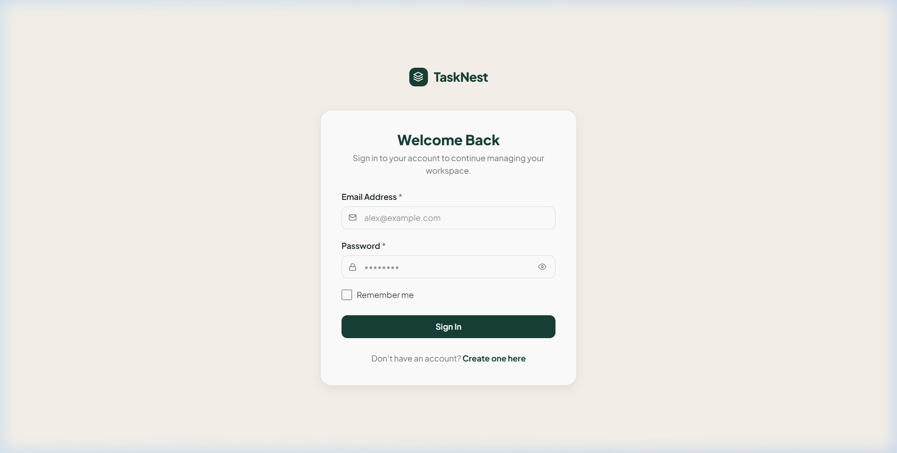
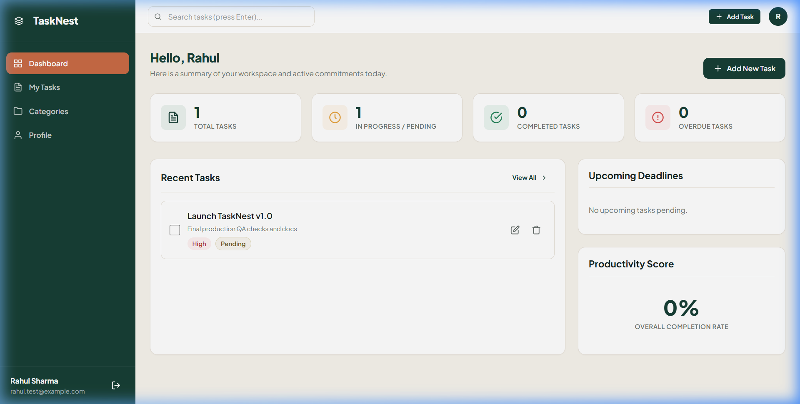
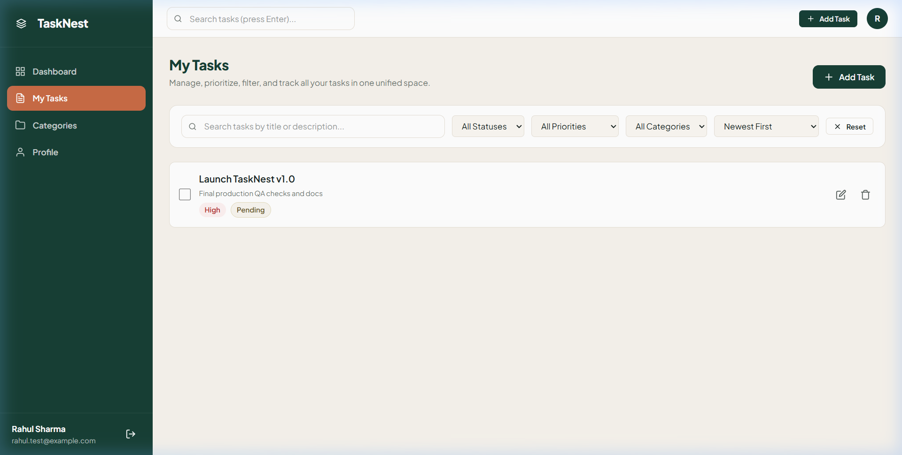
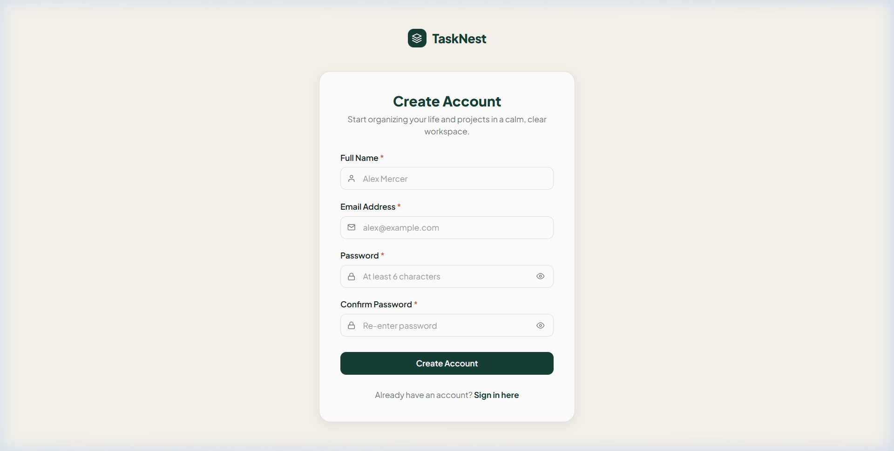

# TaskNest — Modern Task Manager Web Application

[](https://www.python.org/)
[](https://flask.palletsprojects.com/)
[](https://www.sqlite.org/)
[](https://docs.pytest.org/)

**TaskNest** is a full-featured, production-quality personal task management application. Designed around a calm, focused productivity philosophy, TaskNest features a warm cream and deep forest-green aesthetic, real-time database-backed statistics, multi-factor task filtering, and secure user isolation.

---

## Visual Design & Screenshots

### 1. Landing Page
*Warm off-white aesthetic with custom hero banner, productivity value proposition, and workspace demo preview.*


### 2. User Dashboard
*Deep forest-green vertical navigation, real-time database-backed metric cards, quick task addition, and upcoming deadlines.*


### 3. My Tasks Management
*Real-time search, multi-factor filtering (Status, Priority, Category, Sort), checkbox completion, and task actions.*


### 4. Authentication
*Centered warm-white authentication card with show/hide password visibility toggle and validation.*


---

## Technology Stack

- **Backend**: Python 3.10+ & Flask 3.0.3
- **Database**: SQLite
- **ORM**: Flask-SQLAlchemy 3.1.1
- **Authentication & Sessions**: Flask-Login 0.6.3 with secure Werkzeug password hashing
- **CSRF Protection**: Token-based double validation on non-safe HTTP methods
- **Frontend**: HTML5, CSS3 Custom Properties (Design Tokens), Vanilla JavaScript (ES6 Modules)
- **Typography**: Plus Jakarta Sans (Google Fonts)
- **Testing**: pytest 8.2.0 & Flask Test Client

---

## Project Structure

```
Task-Manager-Web-App/
├── app/
│   ├── __init__.py           # Flask app factory, extensions, CSRF, CLI commands
│   ├── models.py             # User, Category, and Task database models
│   └── routes/
│       ├── __init__.py
│       ├── web.py            # Page routes (landing, login, signup, dashboard, tasks, categories, profile, settings)
│       ├── auth.py           # /api/auth endpoints (signup, login, logout, me, profile, change-password)
│       ├── tasks.py          # /api/tasks endpoints (CRUD, search, filters, complete toggle)
│       ├── categories.py     # /api/categories endpoints (CRUD, safe unassign)
│       ├── stats.py          # /api/stats endpoint (real metrics, overdue calculations)
│       └── utils.py          # Standard JSON API envelopes & role authorization decorators
├── templates/
│   ├── base.html             # Base layout, meta tags, CSRF, fonts, global task modal
│   ├── _app_layout.html      # App shell (forest-green sidebar, header, user avatar)
│   ├── index.html            # Public landing page
│   ├── login.html            # Sign-in page
│   ├── signup.html           # Registration page
│   ├── dashboard.html        # Main dashboard with 4 metric cards & upcoming panel
│   ├── tasks.html            # My Tasks view with multi-filter bar and search
│   ├── categories.html       # Category workspace management
│   ├── profile.html          # User account info and session details
│   └── settings.html         # User settings (display name edit, secure password change)
├── static/
│   ├── css/
│   │   └── style.css         # Complete design system & custom properties
│   └── js/
│       ├── api.js            # Fetch wrapper with CSRF injection & toast system
│       ├── auth.js           # Auth forms, validation, and password toggles
│       ├── settings.js       # Profile edit & secure change-password handler
│       └── tasks.js          # Task manager, live filters, modals, and stats
├── tests/
│   ├── conftest.py           # Isolated in-memory SQLite fixtures & test clients
│   ├── test_auth.py          # Registration, login, hashing, session tests
│   ├── test_employee_access.py # Role-based access, profile updates, password change tests
│   ├── test_tasks.py         # Task CRUD, filters, complete/reopen, user isolation
│   ├── test_categories.py    # Category CRUD, duplicate prevention, safe deletion
│   ├── test_stats.py         # Real metric calculations & overdue task rules
│   └── test_csrf.py          # CSRF protection verification
├── docs/
│   ├── api-contract.md       # Standardized API endpoint contract
│   ├── database-schema.md    # Database tables, types, and relationship documentation
│   └── screenshots/          # Application screenshots
├── instance/                 # SQLite database storage (git-ignored)
├── .env.example              # Environment variables template
├── .gitignore                # Git change safety rules
├── requirements.txt          # Python dependencies
├── run.py                    # Application entry point
└── README.md                 # Complete documentation
```

---

## Setup & Execution Guide (Windows & VS Code)

### 1. Prerequisites
- **Python 3.10, 3.11, or 3.12** installed on Windows.
- **Git for Windows** installed.
- **PowerShell** or **Command Prompt** (integrated into VS Code).

Verify your Python installation:
```powershell
python --version
```

### 2. Open Project in VS Code
Open the repository directory in VS Code or clone it:
```powershell
git clone https://github.com/kondapatirahul/Task-Manager-Web-App.git
cd Task-Manager-Web-App
code .
```

### 3. Create & Activate Virtual Environment
In the VS Code terminal (PowerShell):
```powershell
python -m venv .venv
.venv\Scripts\activate
```
*(If PowerShell restricts script activation, run `Set-ExecutionPolicy -ExecutionPolicy RemoteSigned -Scope CurrentUser` once).*

### 4. Install Dependencies
```powershell
pip install -r requirements.txt
```

### 5. Configure Environment Variables
Copy `.env.example` to `.env`:
```powershell
Copy-Item .env.example .env
```
Default `.env` settings:
```ini
SECRET_KEY=dev-secret-key-tasknest-2026
DATABASE_URL=sqlite:///tasks.db
```

### 6. Initialize SQLite Database
Initialize all database tables cleanly without dropping existing data:
```powershell
flask --app run.py init-db
```
*Output: `Database initialized successfully.`*

### 7. Run the Application
Start the development server:
```powershell
python run.py
```

### 8. Open in Browser
Open your browser and navigate to:
```
http://127.0.0.1:5000
```

---

## Running Automated Tests

Run the complete test suite using `pytest`:
```powershell
python -m pytest -v
```
All 23 test suites run against an isolated in-memory SQLite database, guaranteeing that existing application records are never modified during testing.

Test coverage covers:
- User signup and duplicate-email rejection.
- Password hashing and authentication failure handling.
- Session persistence and protected web routes.
- Task CRUD operations, validation rules, and completion toggles.
- Substring search and compound filter combinations.
- User data isolation (User A cannot view, modify, or delete User B's records).
- Category management and safe task-unassignment upon category deletion.
- Real-time dashboard statistics and overdue calculation logic.
- CSRF forgery prevention.

---

## Database Inspection & Backup

### Backup SQLite Database
The live database is stored in the `instance/` folder. To create a backup:
```powershell
Copy-Item instance\tasks.db "instance\tasks_backup_$(Get-Date -Format 'yyyyMMdd_HHmmss').db"
```

### Inspect Database using Python CLI
```powershell
python -c "from app import create_app, db; from app.models import User, Task; app = create_app(); app.app_context().push(); print('Users:', User.query.count(), '| Tasks:', Task.query.count())"
```

---

## API Summary

All endpoints return a uniform JSON envelope:
- **Success**: `{"ok": true, "data": { ... }}`
- **Error**: `{"ok": false, "error": "Human-readable message"}`

| Method | Endpoint | Description |
|---|---|---|
| `POST` | `/api/auth/signup` | Register new user account |
| `POST` | `/api/auth/login` | Authenticate user session |
| `POST` | `/api/auth/logout` | End user session |
| `GET` | `/api/auth/me` | Current authenticated user profile |
| `GET` | `/api/tasks` | List tasks (supports `q`, `status`, `priority`, `category_id`, `due_before`, `due_after`, `sort`) |
| `POST` | `/api/tasks` | Create new task |
| `GET` | `/api/tasks/<id>` | Get task details by ID |
| `PUT` | `/api/tasks/<id>` | Update existing task |
| `DELETE` | `/api/tasks/<id>` | Delete task |
| `PATCH` | `/api/tasks/<id>/complete` | Toggle task completion status |
| `GET` | `/api/categories` | List user categories with task counts |
| `POST` | `/api/categories` | Create new category |
| `DELETE` | `/api/categories/<id>` | Delete category and safely unassign tasks |
| `GET` | `/api/stats` | Real-time user statistics & overdue counts |

*See [`docs/api-contract.md`](docs/api-contract.md) for full endpoint specifications.*

---

## Common Issues & Troubleshooting

1. **`ModuleNotFoundError: No module named 'flask_login'`**
   - Ensure your virtual environment is active (`.venv\Scripts\activate`) and run `pip install -r requirements.txt`.
2. **`sqlite3.OperationalError: no such table: tasks`**
   - Run `flask --app run.py init-db` to create missing database tables.
3. **`Invalid CSRF token` on custom API clients**
   - When calling state-changing endpoints (`POST`, `PUT`, `DELETE`, `PATCH`) from the frontend, pass the `X-CSRFToken` header from the meta tag or session cookie. The included `static/js/api.js` client automatically handles this.
4. **Port 5000 in use**
   - In `run.py`, you can pass a custom port: `app.run(debug=True, port=5001)`.

---

## License & Credits
Developed with modern software craftsmanship for the TaskNest Web Project.

## TaskNest repair bundle notes (October 2026)

This repair pass fixes several integration issues found during browser review:

- Public `/` stays on the two-column homepage even if a session exists; API `401` responses no longer trigger a global browser redirect.
- Home navigation includes role-specific Admin, Team Lead, and Employee sign-in routes.
- Admin roles (`admin` as well as `super_admin` and legacy `admin_hr`) route to the Admin dashboard after sign-in.
- Employee directory handles the API's actual response shape (`data` is an array), so employee names can render.
- Task messages accept multipart form submissions and optional attachments.
- Work submission upload flow stores the attachment first and links its ID to the submission; review requests use the actual nested endpoint and request field names.
- Header avatar opens Profile.
- Attendance's current-shift duration stays live in `HH:MM:SS` and Today's Hours updates during an active shift.
- Added a task-priority recommendation panel using task priority, due-date urgency, and status.
- Added role-specific dashboard accent palettes and real About/Help homepage sections.

This is a targeted repair pass, not a claim that every planned enterprise feature (notably full project/milestone dependency management, configurable custom recurrence rules, and a dedicated focus analytics module) is complete. Run the tests and manually verify workflows in the target Windows environment before deployment.
